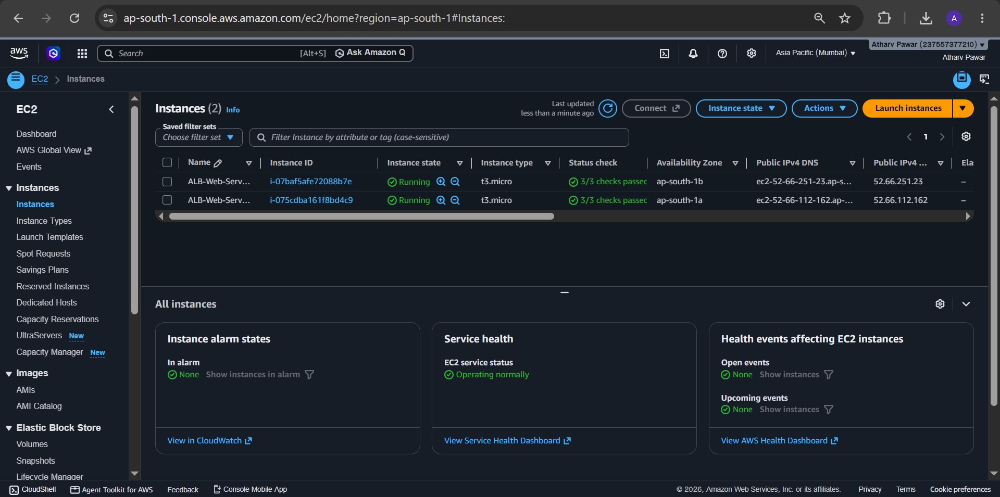
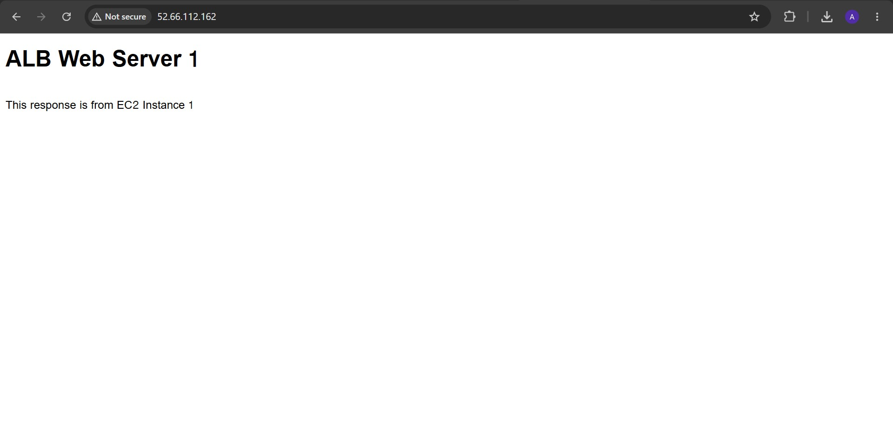
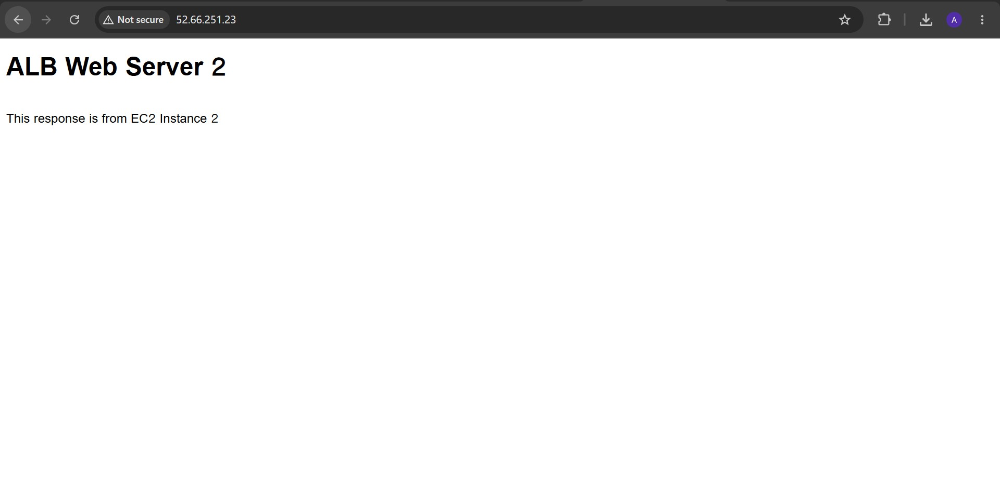
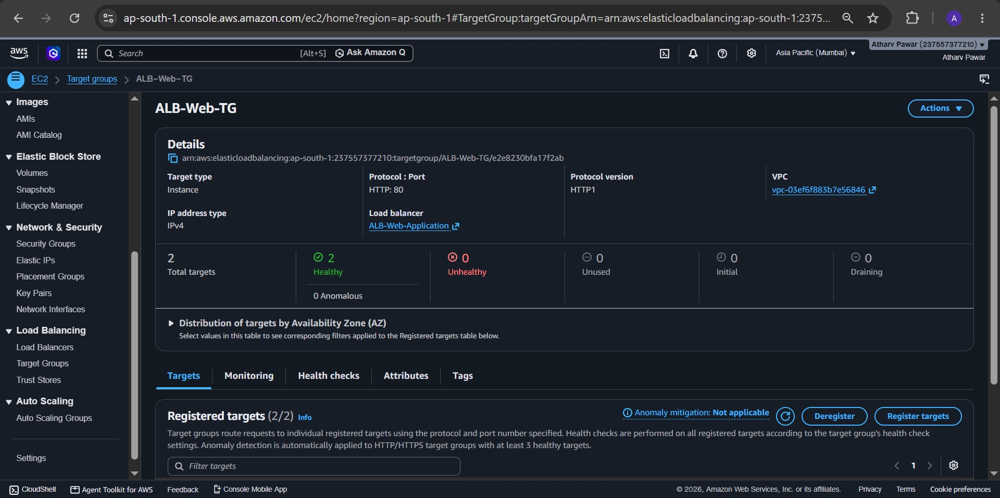
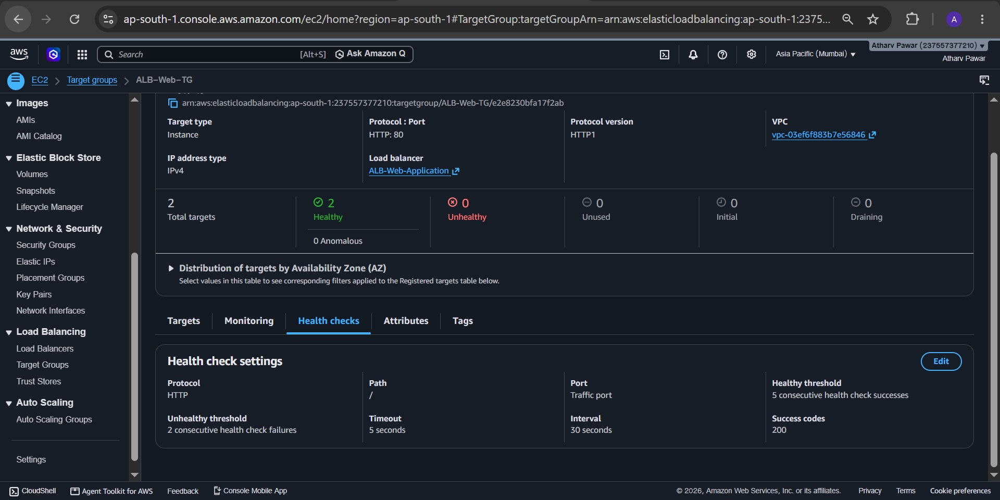
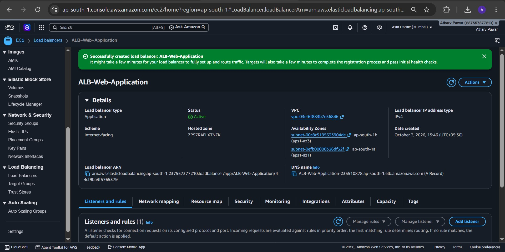
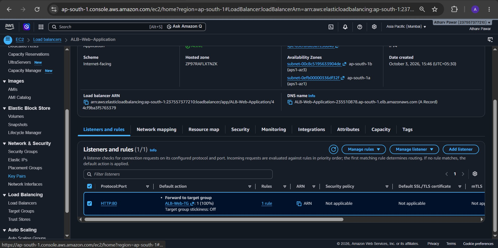
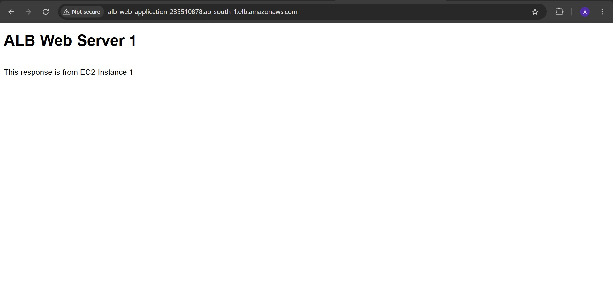
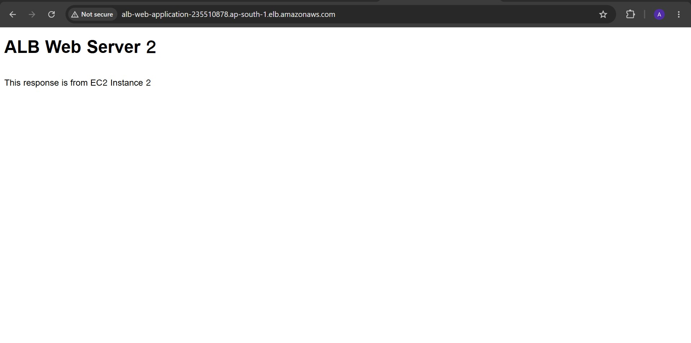
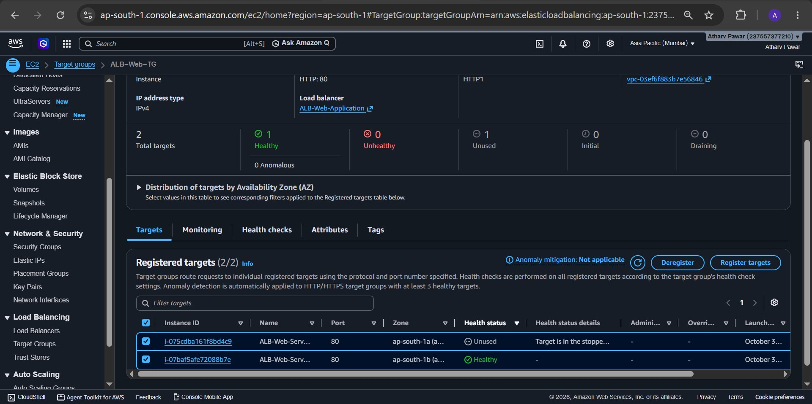

# 🚀 Highly Available Web Application using AWS Application Load Balancer

## 📌 Project Overview

This project demonstrates the deployment of a **Highly Available Web Application** on AWS using multiple Amazon EC2 instances, an Application Load Balancer (ALB), a Target Group, and health checks.

The application is designed so that incoming HTTP traffic is distributed across healthy EC2 web servers. If one EC2 instance becomes unavailable, the Application Load Balancer detects the unhealthy instance through health checks and continues routing traffic to the healthy instance.

---

## 🎯 Project Objective

The main objectives of this project are:

* Deploy multiple web servers using Amazon EC2.
* Install and configure Apache HTTP Server.
* Create an Application Load Balancer.
* Create and configure a Target Group.
* Configure HTTP health checks.
* Distribute incoming traffic across multiple EC2 instances.
* Demonstrate high availability and automatic traffic failover.
* Verify that the application continues working when one instance becomes unavailable.

---

## 🏗️ Architecture

```text
                         Internet
                            │
                            ▼
              ┌──────────────────────────┐
              │   Application Load       │
              │      Balancer (ALB)      │
              │   HTTP : 80              │
              └────────────┬─────────────┘
                           │
                 ┌─────────┴─────────┐
                 │                   │
                 ▼                   ▼
        ┌─────────────────┐  ┌─────────────────┐
        │  EC2 Server 1   │  │  EC2 Server 2   │
        │  Apache HTTPD   │  │  Apache HTTPD   │
        │  Port 80        │  │  Port 80        │
        └─────────────────┘  └─────────────────┘
                 │                   │
                 └─────────┬─────────┘
                           │
                    Target Group
                           │
                    Health Checks
                    HTTP path: /
```

---

## ☁️ AWS Services Used

| Service                   | Purpose                                |
| ------------------------- | -------------------------------------- |
| Amazon EC2                | Hosts the web servers                  |
| Application Load Balancer | Distributes incoming HTTP traffic      |
| Target Group              | Maintains the registered EC2 instances |
| Health Checks             | Monitors the health of EC2 instances   |
| Amazon VPC                | Provides the networking environment    |
| Security Groups           | Controls inbound HTTP and SSH traffic  |

---

## ⚙️ Configuration

### Region

**AWS Mumbai Region — `ap-south-1`**

### EC2 Instances

Two EC2 instances were created:

* `ALB-Web-Server-1`
* `ALB-Web-Server-2`

Both instances were configured as Apache web servers.

### Security Group

The EC2 instances were configured with:

* SSH — Port `22`
* HTTP — Port `80`

The Application Load Balancer security group allows HTTP traffic on port `80`.

---

# 🛠️ Implementation

## 1. Create EC2 Instances

Two Amazon EC2 instances were launched to act as web servers.

```text
ALB-Web-Server-1
ALB-Web-Server-2
```

Both instances were configured with Apache HTTP Server.

### Screenshot



---

## 2. Install Apache on EC2 Server 1

The following commands were used:

```bash
sudo dnf update -y
sudo dnf install -y httpd
sudo systemctl start httpd
sudo systemctl enable httpd
sudo systemctl status httpd
```

A custom web page was created for Server 1:

```bash
echo "<h1>ALB Web Server 1</h1><p>This response is from EC2 Instance 1</p>" | sudo tee /var/www/html/index.html
```

### Server 1 Output



---

## 3. Install Apache on EC2 Server 2

Apache was also installed and configured on the second EC2 instance.

```bash
sudo dnf update -y
sudo dnf install -y httpd
sudo systemctl start httpd
sudo systemctl enable httpd
sudo systemctl status httpd
```

A separate web page was created for Server 2:

```bash
echo "<h1>ALB Web Server 2</h1><p>This response is from EC2 Instance 2</p>" | sudo tee /var/www/html/index.html
```

### Server 2 Output



---

# 🎯 Target Group Configuration

## 4. Create Target Group

A Target Group named:

```text
ALB-Web-TG
```

was created with the following configuration:

* Target type: Instances
* Protocol: HTTP
* Port: `80`
* IP address type: IPv4
* Health check protocol: HTTP
* Health check path: `/`

Both EC2 instances were registered as targets.

### Healthy Targets



---

## 5. Configure Health Checks

The Target Group health check was configured to use:

```text
Protocol: HTTP
Port: Traffic port
Path: /
```

The Application Load Balancer uses this health check to determine whether an EC2 instance can receive traffic.

### Health Check Configuration



---

# ⚖️ Application Load Balancer

## 6. Create Application Load Balancer

An Internet-facing Application Load Balancer named:

```text
ALB-Web-Application
```

was created.

Configuration:

* Load Balancer type: Application Load Balancer
* Scheme: Internet-facing
* IP address type: IPv4
* Listener: HTTP
* Port: `80`
* Target Group: `ALB-Web-TG`

The ALB was configured across multiple Availability Zones.

### Application Load Balancer



---

## 7. Configure ALB Listener

The HTTP listener on port `80` was configured to forward incoming requests to:

```text
ALB-Web-TG
```

### Listener Configuration



---

# 🌐 Application Testing

## 8. Test Application Load Balancer

The Application Load Balancer DNS name was opened in a web browser to verify that the application was accessible through the load balancer.

Example:

```text
http://ALB-Web-Application-235510878.ap-south-1.elb.amazonaws.com
```

### ALB Working


---

## 9. Verify Traffic from Server 1

The ALB was tested to verify that requests could be served by the registered EC2 instances.

### Server 1 Response



---

## 10. Verify Traffic from Server 2

The ALB was also tested to verify the response from the second EC2 instance.

### Server 2 Response



---

# 🔄 Failover Demonstration

## 11. Make One EC2 Instance Unavailable

To demonstrate high availability, **EC2 Server 1** was stopped.

The Target Group health check detected that Server 1 was no longer available and marked the instance as unhealthy.

Server 2 remained healthy and available to serve requests.

### Target Health During Failover



---

## 12. Verify ALB After Failover

Even after EC2 Server 1 became unavailable, the Application Load Balancer continued serving the application through the healthy EC2 Server 2.

This demonstrates the failover capability of the Application Load Balancer using Target Group health checks.

### ALB Working During Failover


---

# ✅ Result

The Highly Available Web Application was successfully implemented using:

* Two Amazon EC2 web servers
* Apache HTTP Server
* Application Load Balancer
* Target Group
* HTTP health checks
* AWS Security Groups

The failover test demonstrated that when one EC2 instance became unavailable, the Target Group detected the unhealthy instance and the Application Load Balancer continued routing requests to the remaining healthy instance.

---

# 📸 Project Screenshots

All project screenshots are available in the [`screenshots`](screenshots/) directory.

| No. | Screenshot                    |
| --- | ----------------------------- |
| 1   | EC2 Instances                 |
| 2   | EC2 Server 1                  |
| 3   | EC2 Server 2                  |
| 4   | Target Group Healthy          |
| 5   | Health Check                  |
| 6   | Application Load Balancer     |
| 7   | ALB Listener                  |
| 8   | ALB Working                   |
| 9   | ALB Traffic - Server 1        |
| 10  | ALB Traffic - Server 2        |
| 11  | Failover - Unhealthy Instance |
| 12  | Failover - ALB Working        |

---

# 🧹 Cleanup

After completing the practical and GitHub submission, AWS resources can be removed to avoid unnecessary resource usage.

Resources to review:

* Application Load Balancer
* Target Group
* EC2 Instances
* Security Groups
* Related networking resources, if created specifically for this project

---

# 📁 Project Structure

```text
high-availability-web-app/
│
├── screenshots/
│   ├── 01-ec2-instances.jpg
│   ├── 02-ec2-server-1.jpg
│   ├── 03-ec2-server-2.jpg
│   ├── 04-target-group-healthy.jpg
│   ├── 05-health-check.jpg
│   ├── 06-application-load-balancer.jpg
│   ├── 07-alb-listener.jpg
│   ├── 08-alb-working.jpg
│   ├── 09-alb-traffic-server-1.jpg
│   ├── 10-alb-traffic-server-2.jpg
│   ├── 11-failover-unhealthy-instance.jpg
│   └── 12-failover-alb-working.jpg
│
└── README.md
```

---

## 👨‍💻 Project Status

**Status: Completed ✅**

This project demonstrates a highly available web application architecture using **Amazon EC2, Application Load Balancer, Target Groups, and health checks on AWS**.
